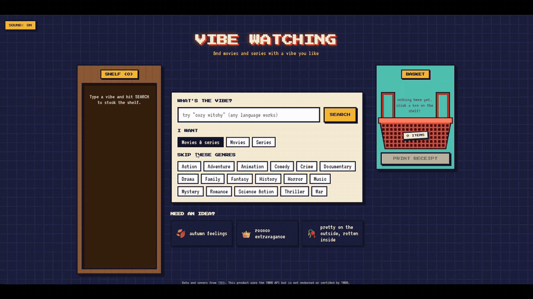

# Vibe Watching

Search movies and series by vibe, not by title or genre. Instead of looking for "horror" or "comedy", you write something like "cozy witchy" or "crazy dream" and the app brings back titles with that feeling. The interface is a pixel-art video rental store: results sit on a shelf, you drop the ones you pick into a basket, and at the end a receipt comes out as a JPEG you can download.

You can type the vibe in any language. The site itself is in English.



Full video (38s): [demo.mp4](docs/demo.mp4)

## Why I built this

I always want to watch something with a very specific feeling and never find it. The closest I got was browsing other people's lists on Letterboxd, trying different words until I found someone who had thought of the same vibe. Also, Letterboxd only has movies, and for me "cozy" can be Practical Magic or Gilmore Girls. Here, movies and series go into the same search, with a filter to pick only one of them.

## How it works

1. Downloads the most voted movies and series from TMDB (synopsis, genres and keywords) and stores them in a SQLite database (about 1,500 titles).
2. Turns the text of each title into an embedding, a list of numbers that represents the meaning of the text (I use Gemini for this).
3. When someone searches, an LLM rewrites the vibe into a clearer description and lists the genres that clearly do not fit. If the vibe is ambiguous, it also proposes 2 or 3 alternative readings, and the results of each reading are merged (reciprocal rank fusion).
4. The search also becomes an embedding and is compared (cosine similarity) with every title. Genres the user marked as "skip" are really removed.
5. The 80 closest titles go through a second LLM, which reorders them and writes one sentence explaining why each one fits.
6. If the LLM fails or is busy, the search falls back to the embedding order and keeps working.

The API is built with FastAPI and the interface with React.

## Project structure

```
backend/      FastAPI app, search, query rewrite, LLM rerank, Gemini wrapper, TMDB client
scripts/      build the database: download titles, generate embeddings, English titles
evaluation/   reference lists, vibe lists and scripts to measure search quality
web/          React interface (Vite)
docs/         demo GIF and video
```

## How I know if it is any good

I built a reference list with vibes and titles that I know fit each one (it is my own taste). `evaluation/evaluate.py` runs the search for each vibe and counts how many of those titles show up in the top 10, so I can compare one method with another using a number instead of just eyeballing results.

Methods compared: `puro` (embedding of the vibe as written), `reescrito` (embedding of the description written by the LLM), `combinado` (vibe + description) and `rerank` (combined + LLM reordering).

**My list (38 titles, 6 vibes)**

| puro | reescrito | combinado |
|---|---|---|
| 8/38 | 9/38 | 11/38 |

On this list the expected titles are in the top 50 in 23 of 38 cases and in the top 100 in 31 of 38 cases (combined).

**My sister's list (27 titles, 7 vibes), used only to measure, with nothing tuned on it**

| puro | reescrito | combinado | rerank |
|---|---|---|---|
| 5/27 | 2/27 | 2/27 | 2/27 |

### Caveats when reading these numbers

* The samples are small. A difference of 2 or 3 titles can be luck.
* The reference list is one person's taste. If the search returns a title that fits the vibe but is not on the list, it does not count. On my sister's list, the vibe "Strangely Cozy" returned The Nightmare Before Christmas, Amélie and Encanto, which make sense, but she had picked Coraline, The Grinch and The Boxtrolls.
* In my tests the rerank scored the same as combined, because it only reorders the candidates: if the right title is not among them, it cannot help.

## What I found so far

* Embedding search finds titles by topic, not by mood. With "cozy witchy" it returned horror movies about witches, which are the opposite of cozy.
* Rewriting the query with an LLM helped on my list and hurt on my sister's. It picks one interpretation, and when the vibe is short or ambiguous it can pick the wrong one.
* "Sisterhood" alone turned into horror with nuns (plain search read it as a religious order) and mafia and gangs (the LLM read it as brotherhood). Nobody understood sisterhood between girls, which is what she meant.
* Embeddings do not understand negation: writing "no horror" in the query pulls in more horror. That is why unwanted genres are filtered out instead of written into the query text.
* The most-voted set leaves out a lot of niche titles, so some expected titles are not even in the database.

## Limitations

* I use the free Gemini plan, which has a daily request limit. When it runs out, search falls back to the no-LLM mode.
* It only has the titles I downloaded from TMDB.
* Synopses and genres in the database are in Portuguese (titles and posters are in English). Embeddings handle both languages, but a full English dataset is on the list.

## Next steps

* Measure with other people: they mark which of the 10 results fit the vibe, instead of me comparing with a fixed list
* Search by a title you like, to find similar movies and series
* Age rating filter
* Generate vibe tags for each title with an LLM and compare with the current version

## How to run

You need Python, Node, a TMDB API key and a Gemini API key.

```
python -m venv .venv
.venv\Scripts\Activate.ps1
pip install -r requirements.txt
```

Create a `.env` file in the root with:

```
TMDB_API_KEY=your_key
GEMINI_API_KEY=your_key
```

Build the database and the embeddings:

```
python -m scripts.download_titles filme 50
python -m scripts.download_titles serie 25
python -m scripts.generate_embeddings
python -m scripts.titles_to_english
```

Search from the terminal:

```
python -m backend.search "cozy witchy"
python -m backend.search "cozy" --tipo serie --sem terror
```

Run the interface (two terminals):

```
uvicorn backend.api:app --port 8000
```

```
cd web
npm install
npm run dev
```

Evaluate the search:

```
python -m evaluation.evaluate
python -m evaluation.evaluate --lista evaluation/data/test_list_sister.json --detalhes
```

Run all commands from the repository root. The database and caches (`filmes.db`, `*.json` caches) are created there and are not committed.

The database (`filmes.db`) and the embedding cache are not in the repository. They are created when you run the scripts.

## Credits

Movie and series data and covers come from [TMDB](https://www.themoviedb.org/). This product uses the TMDB API but is not endorsed or certified by TMDB.

## License

Copyright © 2026 babaleca. Licensed under the [PolyForm Noncommercial License 1.0.0](LICENSE): you are free to use, study, modify and share this project for noncommercial purposes (personal use, learning, hobby projects, research). Commercial use is not allowed.
